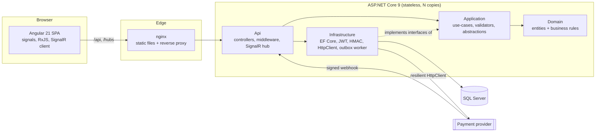
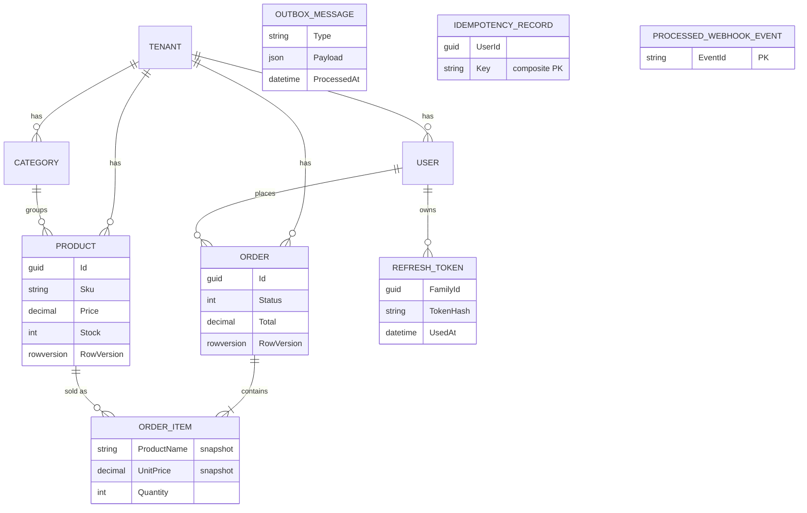
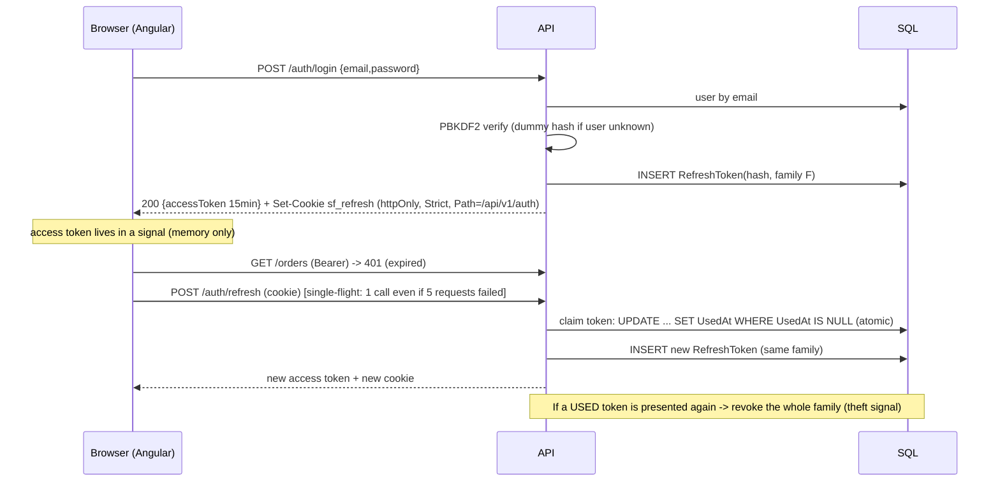
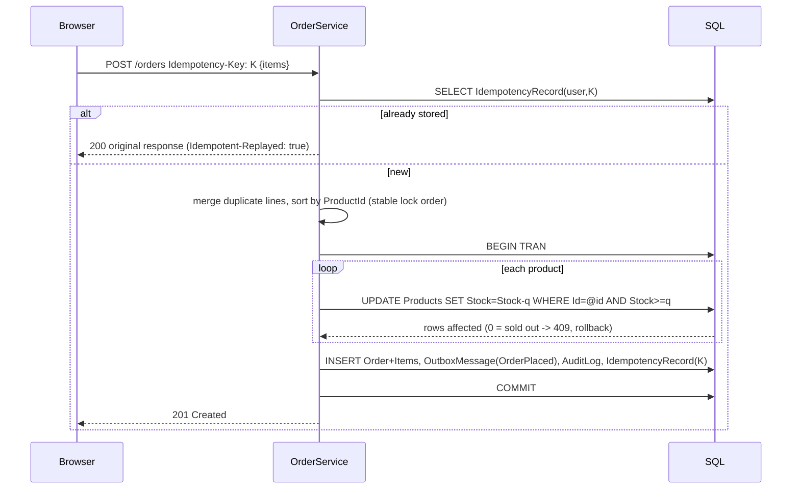

# Architecture

## The product (so the design has a reason)

**ShopFlow** is a multi-tenant online store. Customers browse a catalogue, add to a cart, place an order, pay, and watch the order status
change live. Admins manage stock/prices, ship orders and see a sales report. Two demo stores (**acme**, **globex**) share one database but
can never see each other's data.

It was chosen because it concentrates the problems the kit's *Projects* sheet says "decide offers": **money** (payments + duplicate webhooks),
**concurrency** (last item in stock), **auth done properly**, **multi-tenancy**, **real-time**, and **background work**.

## Layers (Clean Architecture)



**The dependency rule:** arrows of *source-code* dependency point inward. `Domain` references nothing. `Application` references only `Domain`
and defines the interfaces it needs (`IAppDbContext`, `IPaymentGateway`, `IRealtimeNotifier`, `ITokenService`...). `Infrastructure` and `Api`
implement them. Consequences you can feel: the business rules compile and unit-test without a web server or a database, and swapping SQL Server,
the payment provider, or SignalR touches one project.

| Project | Contains | Must NOT contain |
|---|---|---|
| `ShopFlow.Domain` | Entities, `Order` state machine, `DomainException` | EF, HTTP, anything framework-y |
| `ShopFlow.Application` | `OrderService`, `AuthService`, validators, cursor, `IAppDbContext` | Controllers, `HttpContext`, SQL connection strings |
| `ShopFlow.Infrastructure` | `AppDbContext`, migrations, password hasher, JWT, HMAC, outbox, gateways | Business decisions |
| `ShopFlow.Api` | Controllers, middleware, DI wiring, hub | Business logic (controllers are 1-3 lines) |

> **Why not full CQRS/MediatR + a repository per entity?** It adds ceremony without paying for itself at this size. EF's `DbContext` already is a
> unit of work and `DbSet` already is a repository; wrapping them hides `IQueryable` and blocks efficient projections. Use CQRS when read and
> write models genuinely diverge. Being able to *say that* is a senior signal.

## What happens when you press Enter (the kit's classic opener, answered with this app)

You open `https://shop.example.com/orders`:

1. **DNS** resolves the name (browser cache -> OS -> resolver -> authoritative). 2. **TCP** handshake, then **TLS** handshake (certificate check, keys).
3. **HTTP** `GET /orders` hits the CDN/nginx. The path is not a file, so nginx's `try_files` falls back to `index.html` (SPA routing).
4. The browser parses HTML -> builds the **DOM**, fetches CSS (builds **CSSOM**) and the hashed JS bundles (cached for a year, `nginx.conf`).
5. Angular boots. The **app initializer** calls `POST /api/v1/auth/refresh`; the browser attaches the **httpOnly cookie**; the API validates the hash in SQL,
   rotates the token and returns a new short-lived JWT, which is kept **in memory**.
6. The router lazy-loads the `orders-page` chunk; `authGuard` passes; the page calls `GET /api/v1/orders`.
7. In the API: forwarded-headers -> correlation id -> request logging -> exception handler -> security headers -> CORS -> **JWT validation** -> **rate limiter** ->
   authorization -> controller -> `OrderService` -> EF generates `SELECT ... WHERE TenantId=@t AND UserId=@u ... ORDER BY CreatedAt DESC, Id DESC` (seek on
   `IX_Orders_TenantId_UserId_CreatedAt_Id`, no sort) -> JSON.
8. Angular renders with signals + `OnPush`; the **SignalR** connection (WebSocket upgrade through nginx) opens for live updates.
9. Layers that can slow this down, in the order you should suspect them: network/TLS -> bundle size -> API latency -> query plan -> render cost.

## Request pipeline (order matters)

```
forwarded headers  ->  correlation id  ->  request logging  ->  exception handler (problem+json)  ->  security headers
   ->  HSTS/HTTPS redirect  ->  CORS  ->  authentication  ->  rate limiter  ->  authorization  ->  endpoint
```

* Exception handler is **inside** logging so the log shows the final status code, and **outside** everything else so any failure becomes a uniform error body.
* CORS is before authentication so browser preflight `OPTIONS` calls (which carry no token) are answered.
* The rate limiter is after authentication so it can partition per user instead of per IP.

## Data model



Design decisions worth defending in an interview:

* **GUID keys generated in the app** - no round trip to get an id, safe to expose, mergeable across environments. Cost: random GUIDs fragment a clustered index
  (mitigations: sequential GUIDs `Guid.CreateVersion7()`, or an int clustered key + GUID public key).
* **`decimal(18,2)` for money, never float.** `CHECK (Stock >= 0)` as the last line of defence.
* **Snapshot columns on `OrderItem`** (name, unit price): history must not change when the catalogue does. This is *intentional denormalisation*.
* **`TenantId` on `OrderItem`** too, so the tenant filter / row-level security can cover child rows without a join.
* **`rowversion` on `Product` and `Order`** = optimistic concurrency token.
* **Enums stored as int** (`Status`): compact; raw SQL reports use the numbers (documented next to the query). The cost is readability in ad-hoc SQL.

## The five flows you must be able to draw

### 1) Login + silent refresh + rotation



### 2) Place an order (the concurrency centrepiece)



### 3) Payment webhook (idempotent, verified, async side effects)

```mermaid
sequenceDiagram
  participant P as Payment provider
  participant A as API /webhooks/payments
  participant D as SQL
  participant W as OutboxWorker
  participant H as SignalR hub
  participant B as Browser
  P->>A: POST (raw body) X-Signature: t=..,v1=HMAC
  A->>A: verify HMAC (constant-time) + timestamp within 5 min
  A->>D: BEGIN; seen EventId? -> if yes: 200 no-op
  A->>D: Order Pending -> Paid; OutboxMessage(OrderPaid); ProcessedWebhookEvent(EventId); COMMIT
  A-->>P: 200
  W->>D: SELECT TOP 20 ... WITH (UPDLOCK, READPAST)
  W->>H: NotifyUser(order.updated)
  H-->>B: push over WebSocket
  B->>A: GET /orders/{id}  (refetch that one order)
```

### 4) Cancel (compensation)

`Pending -> Cancelled` in one transaction: state machine check (`Order.Cancel()`), **give stock back** with an atomic `Stock = Stock + q`, write outbox + audit.
Races with a payment arriving at the same time are resolved by the `rowversion` on `Order` (loser gets 409). If a payment arrives *after* cancellation
the webhook emits `RefundRequired` instead of silently losing money.

### 5) Admin edits a product (optimistic concurrency)

Client sends the `version` it read. `UPDATE ... WHERE Id=@id AND RowVersion=@version` affects 0 rows if someone saved in between -> EF throws
`DbUpdateConcurrencyException` -> `409 concurrency_conflict`. The Angular page reloads the latest row and asks the admin to re-apply the edit.
Stock changes use **deltas in SQL** instead, because "+1" from two admins should both count.

## Decision log (ADR-style, one paragraph each)

| # | Decision | Why | Trade-off / when to revisit |
|---|---|---|---|
| 1 | Modular monolith | One deployable, one DB transaction across order+stock+outbox, trivial to debug | Split only when teams/scale demand it; module boundaries (folders/projects) make that possible |
| 2 | Shared DB + `TenantId` + EF global filter | Cheapest to operate; isolation by construction at app level | Raw SQL bypasses filters (see `ReportService`); add SQL Server **Row-Level Security** for defence in depth; very large/regulated tenants -> DB-per-tenant |
| 3 | JWT access (15 min) + rotating httpOnly refresh cookie | Stateless API scaling + XSS-resistant long-lived credential | Can't revoke an access token before expiry (15 min window); keep the TTL short |
| 4 | Atomic conditional `UPDATE` for stock | Correct under any concurrency with one statement, no explicit locks to reason about | Hot rows (flash sale on one SKU) serialise on that row: use a queue/sharded counters then |
| 5 | Transactional outbox | Never lose or invent an event relative to the DB commit | At-least-once -> consumers idempotent; polling adds ~2 s latency (use CDC/Service Bus for lower) |
| 6 | Idempotency-Key + dedupe tables | Retries and duplicate webhooks are *normal* | Records must be purged after a TTL (e.g. 24-48 h) |
| 7 | Cursor pagination | Stable and O(log n) | No "jump to page 37"; needs a unique, indexed sort key |
| 8 | In-memory cache + change tokens | Zero infrastructure | Per-instance: invalidation does not cross servers -> Redis when scaling out (see `05`) |
| 9 | `IExceptionHandler` + problem+json | One place maps exceptions to HTTP; stable `code` for clients | Exceptions for control flow cost CPU on hot paths; fine for business errors, use `Result<T>` if it ever shows in a profile |
| 10 | Same-origin deployment (proxy) | No CORS surface, `SameSite=Strict` cookie works, WebSockets simple | Separate API domain needs CORS + `SameSite=None; Secure` + CSRF defences |